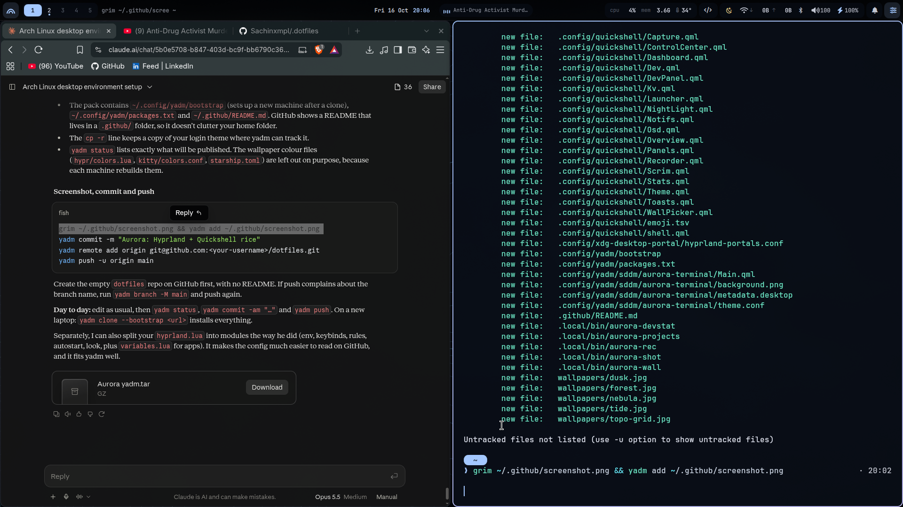

# Aurora · Hyprland dots

A coder-flavoured Hyprland setup for Arch: Quickshell shell, wallpaper-driven colours
(matugen), terminal-style lock & login screens, and dev tools wired into the bar.



| | |
|---|---|
| **WM** | Hyprland 0.56 (Lua config) |
| **Shell / bar** | Quickshell (QML) — bar, launcher, control centre, dashboard, overview, dev panel |
| **Colours** | matugen — everything recolours from the wallpaper (`Super+W`) |
| **Terminal** | kitty · fish · starship |
| **Lock / login** | hyprlock + SDDM "terminal session" theme |
| **Files** | Nautilus |
| **Font** | JetBrains Mono Nerd Font · Inter |

## Features
- **Status line bar** — workspaces, live ↓/↑ network speed, cpu/mem/temp, git branch of the focused terminal, docker + dev-server ports, media, night light
- **Launcher** (`Super`) — apps, `;` clipboard history, `~` git projects → VS Code, `?` web/docs search (`? gh`, `? aw`, `? mdn` …), `:` emoji & dev symbols, `>` run, `=` calc
- **Dev panel** (`Super+Shift+D`) — git status of where you are, docker containers (logs/shell/restart), listening ports (open/kill)
- **Dashboard** (`Super+D`) — calendar, weather, CPU/RAM/GPU/temp graphs, media
- **Overview** (`Super+Tab`) — live window previews, drag windows between workspaces
- **Capture** (`Print`) — region/window/screen shots → clipboard, annotate with satty, screen recording with audio
- **Night light** (`Super+N`) — sunset → sunrise auto mode with smooth fades

## Keybinds
| Keys | Action |
|---|---|
| `Super` | launcher |
| `Super+Return` · `Super+B` · `Super+E` | terminal · browser · files |
| `Super+Q` · `Super+F` · `Super+Shift+F` | close · fullscreen · float |
| `Super+1…9` · 3-finger swipe | workspaces |
| `Super+Tab` | overview |
| `Super+A` · `Super+D` · `Super+Shift+D` | control centre · dashboard · dev panel |
| `Super+V` · `Super+O` · `Super+.` · `Super+/` | clipboard · projects · emoji · web search |
| `Super+W` · `Super+Shift+W` | wallpaper picker · random wallpaper |
| `Super+N` · `Super+Shift+N` | night light on/off · auto |
| `Print` · `Shift+Print` · `Super+Shift+R` | capture menu · region shot · record |
| `Super+L` | lock |

## How it's managed
[yadm](https://yadm.io) — the repo's work tree is `$HOME`, so files stay where they live (no symlinks).
Generated files (wallpaper colours) aren't tracked; `~/.config/yadm/bootstrap` sets up a new machine.

## Install
```sh
sudo pacman -S yadm
yadm clone --bootstrap https://github.com/<you>/dotfiles
```
Hybrid Intel + NVIDIA laptops: apps run on the iGPU; use `prime-run <app>` for the dGPU.
